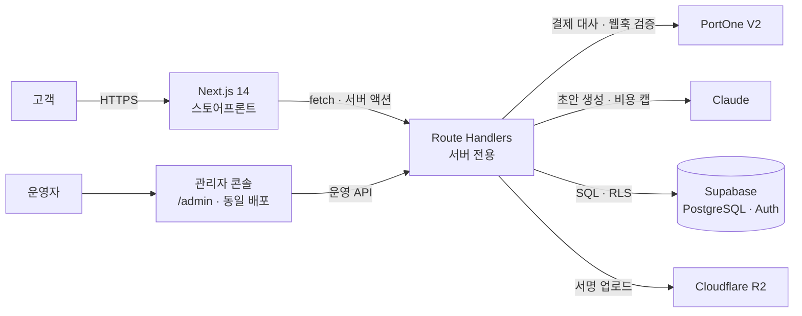

# PROJECT B 설계문서

> **이 문서는 역설계된 설계문서다.** PROJECT B 는 설계문서 없이 시작해 127 개 커밋을 쌓았고,
> 이 문서는 코드·커밋·`CLAUDE.md` 에서 결정을 거꾸로 복원한 것이다.
> 확인하지 못한 항목은 `(미확인)` 으로 표시했다. 추정을 사실처럼 적지 않는다.
>
> **이 저장소는 공개(public)다.** 따라서 이 문서에는 사업 계약·단가·거래처 식별 정보를 새로 싣지 않는다.
> 관련해서 이미 발생한 문제는 §19 O1 에 적었다.

| 항목 | 내용 |
|---|---|
| **작성자** | 고경석 (kugll9606@gmail.com) |
| **작성일** | 2026-09-16 |
| **대상 리비전** | `main` @ `6d0bd61` |
| **저장소** | `projectb-studio/projectB-web` (공개) |
| **상태** | 역설계 초안 — 리뷰 전 |
| **정본 위치** | `docs/design/DESIGN.md` |

---

## 0. 이 프로젝트에 설계문서가 필요한가

[Refactoring English, *Write an Effective Design Doc*](https://refactoringenglish.com/excerpts/write-an-effective-design-doc/)
의 판정 질문. 기준은 **"틀렸을 때의 비용"** 이다.

| 판정 질문 | PROJECT B |
|---|---|
| 여러 사람이 협업하는가 | **예** — 개발자 1 인 + 발주처 운영자. 운영자가 실제로 시스템을 쓴다 |
| 3 개월 이상 full-time 규모인가 | **예** — 2026-03-31 ~ 2026-08-17, 약 4.5 개월 |
| 구현이 수년간 프로덕션에서 도는가 | **예** — 실매장 온라인 채널 |
| 팀 간 협업이 필요한가 | 부분적 — 후속 Delfina 와 DB 를 공유할 계획이 있다 |
| 목표·요구사항이 모호한가 | **예** — 오프라인이 메인인 쇼핑몰이라는 전제가 페이지 우선순위를 뒤집는다 |
| 설계 시점에 막을 수 있는 치명적 위험이 있는가 | **예** — 결제 검증, 개인정보, 공개 저장소의 사업 문서 노출, LLM 환각의 대외 발행 |

6 개 중 5 개가 "예"다. 특히 마지막이 실제 비용을 발생시켰다 —
**공개 저장소에 사업 계약 문서가 커밋돼 있다**(§19 O1). 설계 시점의 한 줄
("공개 저장소에는 사업 문서를 두지 않는다")로 막을 수 있었던 일이다.

---

## 1. Objective (목적)

> 오프라인 매장이 본진인 핸드메이드 소품 브랜드의 온라인 채널을,
> 운영자가 개발자 없이 굴릴 수 있는 수준으로 만든다.

---

## 2. Background (배경)

PROJECT B 는 자체 제작 악세사리·소품을 파는 브랜드다. **오프라인 매장이 메인이고 온라인이 추가**다.
이 순서가 일반적인 쇼핑몰과 반대이며, 그 결과 설계가 두 군데에서 달라진다.

1. **Store Location 페이지가 핵심 페이지다.** 보통 쇼핑몰에서 매장 안내는 부록이지만
   여기서는 전환 목적지 중 하나다.
2. **상품 수가 10 ~ 50 개로 적다.** 카탈로그 규모가 작으므로 검색·필터보다
   **개별 상품 페이지의 밀도**가 매출을 좌우한다. 이것이 상품 상세 블록형 CMS 와
   AI 초안 기능이 들어온 이유다.

**이전 시도**: 없다. 기성 솔루션(카페24·스마트스토어) 대신 자체 구축을 택했고,
관리자 기능은 스마트스토어를 벤치마킹해 P0/P1 을 잘랐다 (`8f35d2b`).

**운영자 제약이 설계를 지배한다.** 발주처는 개발자가 아니다.
상품 하나를 올릴 때마다 개발자를 부르면 안 된다는 조건이 관리자 콘솔의 범위를 정했다.

---

## 3. Related Documents (관련 문서)

| 문서 | 내용 |
|---|---|
| [`CLAUDE.md`](../../CLAUDE.md) | 기술 스택·디자인 시스템·사이트맵 단일 원본 |
| [`docs/PROJECT_KNOWLEDGE_BASE.md`](../PROJECT_KNOWLEDGE_BASE.md) | 축적 지식 |
| [`docs/guides/ai-draft-review.md`](../guides/ai-draft-review.md) | AI 초안 검수 가이드 |
| [`docs/research/ai-draft-v2-research.md`](../research/ai-draft-v2-research.md) | AI 초안 v2 리서치 |
| [`docs/superpowers/plans/`](../superpowers/plans/) | 기능별 구현 계획 |
| [`supabase/`](../../supabase/) | 스키마·마이그레이션·시드 |

---

## 4. Goals (목표)

1. **운영자가 개발자 없이 상품을 올리고 판다.** 등록·수정·발행·주문·회원·통계가 콘솔 안에서 끝난다.
2. **결제가 신뢰 가능하다.** 클라이언트가 보낸 금액을 믿지 않고 서버가 PG 에 재확인한다.
3. **상품 페이지가 스스로 설득한다.** 블록형 편집기와 AI 초안으로 상세 밀도를 올린다.
4. **LLM 이 쓴 문장이 검수 없이 대외로 나가지 않는다.**
5. **템플릿처럼 보이지 않는다.** 브랜드가 디자인으로 식별된다.

## 5. Non-goals (비목표)

- **범용 쇼핑몰 솔루션을 만들지 않는다.** 이 브랜드 하나에 맞춘다.
- **다국어·해외 배송을 하지 않는다.**
- **재고 자동 연동·ERP 연동을 하지 않는다.** 상품 수가 적어 수동으로 감당된다.
- **AI 가 상품 정보를 자동 발행하지 않는다.** 초안까지만이고 발행은 사람이 한다.
- **마이크로서비스로 쪼개지 않는다.** 스토어프론트와 관리자가 같은 Next.js 배포다.
- **Delfina(의류)를 이번 범위에서 만들지 않는다.** DB 공유 규약(`pb_`/`df_` prefix)만 미리 정해둔다.

---

## 6. Scenarios (시나리오)

### S1. 고객이 상품을 사간다
1. 홈 또는 카테고리에서 상품을 고른다.
2. 상품 상세에서 블록형 콘텐츠(이미지·텍스트·스펙)를 읽는다.
3. 장바구니 → 체크아웃.
4. 브라우저가 PortOne SDK 로 **결제를 시작만** 한다.
5. **서버가 PortOne API 로 결제 건을 다시 조회해 금액·상태를 검증**한다.
6. 검증을 통과해야 주문이 확정된다.

### S2. 운영자가 상품을 올린다
1. `/admin/products` 에서 상품을 등록한다.
2. 등록 직후 **AI 상세 초안 생성**으로 이어진다 (`bc7559b`).
3. 초안은 `draft` 상태로만 저장된다 — 아직 고객에게 보이지 않는다.
4. 검수 UI 가 품질 표시와 함께 초안을 보여준다.
5. 운영자가 고치고 **발행**을 눌러야 발행 경계를 넘는다.

### S3. LLM 이 헛소리를 쓴다
1. 초안 생성 요청이 들어온다.
2. **비용 하드캡**이 먼저 호출량을 막는다 (`9f760d7`).
3. Structured Outputs 로 스키마를 강제한다 — 포인트 개수까지 스키마로 보장한다 (`9da6629`).
4. **결정론적 카피 검사기**가 상투어·이모지를 걸러낸다 (`2639a49`).
5. **LLM 비평가**가 한 번 더 본다 (`863453e`).
6. 그래도 남으면 **운영자 검수**가 마지막 관문이다.
7. 제작 기법 환각은 별도로 차단했다 (`c291c8c`) — few-shot 오염이 원인이었다.

### S4. 고객이 매장을 찾아온다
Store Location 페이지가 매장 정보와 지도를 보여준다. **온라인 전환만큼 중요한 목적지다.**

---

## 7. Diagrams (도면)

- **시스템 구성**: [`diagrams/architecture.html`](diagrams/architecture.html) — 원본 명세 [`architecture.json`](diagrams/architecture.json)

archify 로 생성했고 **JSON 명세가 원본, HTML 은 산출물**이다.

---

## 8. Glossary (용어)

| 용어 | 뜻 |
|---|---|
| **발행 경계 (publish boundary)** | LLM 초안이 `draft` 에서 고객에게 보이는 상태로 넘어가는 지점. 사람 검수가 유일한 통과 수단이다 |
| **품질 루프 (quality loop)** | 생성 → 검사 → 재생성을 정해진 횟수만 도는 bounded 반복. 무한 재시도를 막는다 |
| **결정론적 카피 검사** | LLM 없이 규칙으로 잡는 검사 (상투어·이모지·금칙어). LLM 비평가보다 앞단에 둔다 |
| **비용 하드캡** | LLM API 호출 비용의 절대 상한. 넘으면 호출 자체를 거부한다 |
| **RLS** | Supabase PostgreSQL 의 Row Level Security. 권한을 DB 가 집행한다 |
| **Industrial Minimal** | 이 프로젝트의 디자인 방향. 모든 모서리 직각, 대문자 제목, 흑백 기조 |

---

## 9. Constraints (제약)

- **운영자가 비개발자다.** 콘솔에서 안 되는 일은 사실상 안 되는 일이다.
- **개인사업자 · 통신판매업 신고 완료.** 전자상거래법상 표시 의무가 따라온다.
- **세금계산서 발행이 필요하다.** 기업 고객이 있다.
- **도메인 `projectB.com` 이 이미 사용 중이다.** 대안 미정 — 발행 전에 정해야 한다 (§19 O2).
- **후속 Delfina 와 Supabase DB 를 공유한다.** 테이블 prefix 로 분리(`pb_`/`df_`)하기로 했고,
  이 규약은 지금 어기면 나중에 되돌리기 어렵다.
- **상품 수가 10 ~ 50 개다.** 대규모 검색·추천 인프라가 필요 없다.

---

## 10. Service Level Objectives (SLO)

**정량 SLO 가 정의돼 있지 않다.** 부하 시험이나 프로덕션 지연 분포 수집을 한 기록이 없다.
지금 이 문서에서 목표치를 지어내지 않는다.

측정 없이 말할 수 있는 것은 구조적 사실뿐이다.

| 항목 | 현재 상태 |
|---|---|
| 가용성 | Vercel · Supabase 의 관리형 가용성에 전적으로 의존 (자체 다중화 없음) |
| 지연 | 미측정 |
| 규모 | 상품 10 ~ 50 개, 트래픽 목표 미정의 |
| 결제 정합성 | 서버 재검증으로 구조적 보장. **다만 실패 재시도·부분 실패 처리는 미확인** |

§19 O4 로 남긴다.

---

## 11. Monitoring / Alerting (관측·알림)

**전용 관측 스택이 없다.** Vercel 과 Supabase 의 기본 대시보드에 의존한다.

- **AI 초안**: 비용 가드(`cost-guard.ts`)가 사용량을 추적하고 상한에서 차단한다.
  `.ai-draft-usage.json` 이 사용량 상태를 들고 있다.
- **평가 하네스**: `src/lib/ai-draft/eval/` 에 생성 품질 평가 장치가 있다.
  이건 관측이라기보다 회귀 방지에 가깝다.
- **알림 (미확인)**: 결제 실패·주문 이상에 대한 알림 경로를 확인하지 못했다.
  Kakao Alimtalk 이 `CLAUDE.md` 아키텍처 도식에 있으나 구현 여부는 확인하지 않았다.

**이건 알려진 공백이다** (§19 O4). 돈을 받는 시스템에 결제 실패 알림이 없다면 그건 설계 결함이다.

---

## 12. Timeline (마일스톤)

| 시기 | 마일스톤 | 남은 산출물 |
|---|---|---|
| 2026-03-31 | 홈 페이지 | 첫 PR, 디자인 시스템 적용 |
| 2026-04 초 | P2 — 인증 · 결제 · 주문 | PortOne V2 연동, 서버 검증 |
| 2026-04 | 관리자 Phase 1 ~ 3 | 기반 · 상품 · 리뷰/문의/공지 |
| 2026-04 | 매거진 · 테마 스위처 | — |
| 2026-05 ~ 06 | 관리자 P5 | 회원 관리, 통계 대시보드(recharts 6 종), 블록형 CMS 편집기 |
| 2026-07 | 관리자 v2 | 스마트스토어 벤치마킹 P0/P1, RLS 재귀 해결 |
| 2026-08 | AI 초안 v1 → v2 | 환각 격리, 비용 캡, 품질 루프, 법정 고지 블록, 발행 게이트 |

---

## 13. Interfaces (인터페이스)

### 사용자 인터페이스

| 영역 | 라우트 |
|---|---|
| 스토어프론트 | `/`, `/category`, `/product/[slug]`, `/cart`, `/checkout`, `/order-complete` |
| 브랜드 | `/brand`, `/magazine`, **`/store-location`** |
| 고객 | `/mypage`, `/auth`, `/reviews`, `/cs`, `/notice` |
| 법정 | `/terms`, `/privacy` |
| 관리자 | `/admin/{products,orders,members,stats,content,magazine,marketing,notices,inquiries,settings,drafts}` |

### API

Next.js Route Handler **55 개**. 그룹: `admin` · `auth` · `checkout` · `orders` ·
`reviews` · `inquiries` · `notices` · `faq` · `search` · `settings`.

### 디자인 시스템 (인터페이스 계약으로 취급한다)

`CLAUDE.md` 에 규칙이 명문화돼 있고 **위반이 곧 버그**다.

- 모든 모서리 `border-radius: 0`
- 제목은 대문자 + 넓은 자간 (0.15 ~ 0.25 em)
- 제목 **Archivo**, 본문 **Pretendard Variable**
- 흑백 기조 + 세일 레드 단일 액센트
- 상품 이미지 1:1
- *"Generic AI aesthetic is STRICTLY FORBIDDEN"* — Inter · Roboto · 보라 그라디언트 금지

---

## 14. Dependencies / Infrastructure (의존성·인프라)

**바꾸기 어려운 결정만 적는다.**

| 층 | 선택 | 바꾸기 어려운 이유 |
|---|---|---|
| 언어·프레임워크 | TypeScript (strict) / Next.js 14 App Router | 스토어프론트와 관리자가 **한 배포**라는 구조가 여기서 나온다 |
| 데이터 | Supabase PostgreSQL | 권한을 **RLS 로 DB 가 집행**한다 — 앱 레벨 권한 체크로 되돌리기 어렵다 |
| 인증 | Supabase Auth (카카오·네이버·구글) | 세션 모델이 RLS 정책과 묶여 있다 |
| 이미지 | Cloudflare R2 | **파일 저장소를 이원화하지 않는다** — Supabase Storage 를 쓰지 않기로 했다 |
| 결제 | **PortOne V2** (`@portone/browser-sdk/v2`) | 결제 대사 로직과 웹훅 계약이 PG 에 묶인다 |
| LLM | Anthropic Messages API **직접 호출** (SDK 미사용) | 비용 가드·품질 루프를 호출 경로에 직접 끼우기 위함 |
| 배포 | Vercel | — |
| 상태 | Zustand (클라이언트) | — |

> **README 와 코드가 불일치한다.** `README.md:14` 는 `Payment: Tosspayments` 라고 적혀 있으나
> 실제 코드는 PortOne V2 다 (`src/app/checkout/page.tsx`, `src/app/api/checkout/route.ts`).
> `CLAUDE.md` 는 PortOne 으로 맞다. **README 가 틀렸다** — §19 O3.

---

## 15. Security (보안)

- **신뢰 경계**: 브라우저 ↔ Route Handler. **클라이언트가 보낸 금액을 신뢰하지 않는다.**
- **결제**: 브라우저는 PortOne SDK 로 결제를 시작만 하고,
  서버가 `GET https://api.portone.io/payments/{paymentId}` 로 재조회해 검증한다.
  API Secret 은 서버 전용 환경변수다.
- **권한**: Supabase RLS 가 DB 레벨에서 집행한다. 앱이 우회할 수 없다.
  RLS 정책 재귀 문제를 한 번 겪고 해결했다 (`77d416d`).
- **차단 사용자**: `BlockedError` + `assertNotBlocked` 가드 (`9df6b08`).
- **XSS**: 상세 블록은 **서버 사이드 HTML 새니타이저**를 거친다 (`c79a1a9`).
  블록형 CMS 가 HTML 을 다루므로 이 경로가 핵심 공격 표면이다.
- **비밀값**: 환경변수로만 주입. `.env` 는 추적되지 않는다.
- **미검토 (미확인)**: CSP 헤더, PortOne 웹훅 서명 검증 여부,
  관리자 라우트의 rate limiting 을 이 문서에서 확인하지 않았다.

## 16. Privacy (프라이버시)

- **다루는 민감 데이터**: 회원 식별자, 주문 내역, **배송지 주소**, 결제 참조 정보.
  배송지는 실주소이고 가장 민감한 축이다.
- **저장 위치**: Supabase PostgreSQL. 접근은 RLS 로 제한.
- **결제 정보**: 카드 정보는 보유하지 않는다 — PG 가 처리하고 참조 ID 만 받는다.
- **정책 문서**: `/privacy`, `/terms` 페이지와 `docs/개인정보처리방침.md`, `docs/이용약관.md`.
- **보관 기간 (미확인)**: 주문·회원 데이터 보관 기간 정책이 코드에 구현돼 있는지 확인하지 않았다.
  전자상거래법상 거래 기록 보존 의무(5 년)와 개인정보보호법상 파기 의무가 충돌하는 지점이라
  확인이 필요하다 (§19 O5).

## 17. Legal Considerations (법적 고려)

- **전자상거래법**: 통신판매업 신고 완료. 사업자 정보·청약철회·교환반품 고지 표시 의무.
  AI 초안 v2 에 **법정 고지 블록**이 레시피로 들어간 이유가 이것이다 (`5570827`).
- **세금계산서**: 기업 고객 대상 발행 필요.
- **라이선스 (미확인)**: 저장소가 **공개인데 LICENSE 파일이 확인되지 않는다.**
  라이선스 없는 공개 저장소는 기본적으로 All Rights Reserved 지만,
  공개 의도와 실제 권리 상태가 일치하는지 명시해야 한다 (§19 O1).
- **AI 생성 문구의 책임**: 상품 설명은 표시광고법 적용 대상이다.
  발행 경계에 사람 검수를 둔 것은 기술적 선택이자 **법적 책임 구조**다.

## 18. Logging (로깅)

- **AI 초안**: 호출 비용·사용량을 `cost-guard` 가 기록한다.
- **애플리케이션 로그**: Vercel 기본 로그에 의존한다. 구조화 로깅 계층이 없다.
- **감사 로그 (미확인)**: 관리자 작업(상품 수정·회원 차단·주문 상태 변경)에 대한
  감사 로그가 있는지 확인하지 않았다. 운영자가 여럿이 되면 필요해진다.
- **민감값 제외 (미확인)**: 로그에서 주소·연락처가 마스킹되는지 확인하지 않았다.

---

## 19. Open Issues (미결 이슈)

| # | 문제 | 선택지 | 다음 행동 |
|---|---|---|---|
| **O1** | **공개 저장소에 사업 문서가 커밋돼 있다.** `docs/contracts/` 의 용역계약서·견적서 PDF, `docs/guides/` 의 사장님 계정생성 가이드가 `git ls-files` 에 잡힌다 | (a) 저장소를 비공개로 전환 (b) 해당 파일을 히스토리에서 제거하고 `.gitignore` 에 추가 (c) 발주처 동의 하에 유지 | **발주처에 먼저 알린다.** 히스토리 재작성은 되돌릴 수 없으므로 결정 전에 실행하지 않는다 |
| **O2** | 도메인 미정. `projectB.com` 사용 중 | — | 발행 전에 확정. SEO·OG·메일 발신 도메인이 여기 묶인다 |
| **O3** | README 의 결제 PG 표기가 코드와 다르다 (Tosspayments ↔ PortOne V2) | — | README 를 고친다. 단순 오기이지만 공개 문서라 오해 비용이 있다 |
| **O4** | **결제 실패·주문 이상 알림 경로가 확인되지 않는다** | (a) Alimtalk 연동 (b) 이메일 (c) 관리자 대시보드 배지 | 실패 시 아무도 모르는 상태인지부터 확인한다 |
| **O5** | 개인정보 보관·파기 정책이 코드에 구현됐는지 미확인 | — | 전자상거래법 보존 의무와 개인정보 파기 의무의 경계를 정리한다 |
| **O6** | LICENSE 파일 부재 (공개 저장소) | — | 공개 의도를 확정하고 명시한다 |
| **O7** | Delfina 와의 DB 공유 규약(`pb_`/`df_`)이 실제 스키마에 일관 적용됐는지 미검증 | — | `supabase/schema.sql` 을 prefix 기준으로 감사한다 |

## 20. Resolved Issues (해결된 이슈)

| # | 문제 | 결정 | 근거 |
|---|---|---|---|
| **R1** | LLM 이 **제작 기법을 지어냈다** | few-shot 오염 제거 + 기법 환각 차단 | `c291c8c` — 예시가 모델을 오염시키고 있었다 |
| **R2** | LLM 초안이 검수 없이 나갈 수 있었다 | **발행 경계** 도입 — 초안은 `draft` 로만 저장, 발행은 사람이 | `cadb700` "AI 상품 상세페이지 초안 → 운영자 검수/발행 분리 (환각 격리)" |
| **R3** | LLM 비용이 무제한이었다 | **하드캡 가드** | `9f760d7` |
| **R4** | 생성 결과의 포인트 개수가 들쭉날쭉했다 | Structured Outputs 로 스키마 강제 | `9da6629` |
| **R5** | 품질 검사를 LLM 에만 맡기면 느리고 비쌌다 | **결정론적 카피 검사기**를 앞단에, LLM 비평가를 뒤에 | `2639a49`, `863453e` |
| **R6** | Supabase **RLS 정책이 재귀**해 관리자 화면이 깨졌다 | 정책 재작성 | `77d416d` |
| **R7** | 상세 블록이 HTML 을 그대로 렌더해 XSS 위험이 있었다 | 서버 사이드 새니타이저 | `c79a1a9` |
| **R8** | 이모지 정규식이 ES5 타깃에서 깨졌다 | ES5 호환 표현으로 수정 | `4247d54` |

---

## 21. Alternatives Considered (검토한 대안)

**기성 솔루션 (카페24 · 스마트스토어 · 쇼피파이)** — 기각.
다만 **관리자 UX 는 스마트스토어를 벤치마킹**해 P0/P1 을 잘랐다 (`8f35d2b`).
쓸 만한 부분만 가져오고 플랫폼 종속은 피한 선택이다.

**Supabase Storage** — 기각. 파일 저장소를 R2 와 이원화하지 않기로 했다.
같은 종류의 자산이 두 곳에 나뉘면 URL 규칙·백업·비용이 모두 두 벌이 된다.

**Anthropic SDK 사용** — 기각. Messages API 를 직접 호출한다.
비용 가드·품질 루프·스텁 프로바이더를 호출 경로에 직접 끼워야 했고,
SDK 추상화가 그 지점을 가렸다. 대신 `anthropic-client.ts` 를 직접 유지보수하는 비용을 진다.

**AI 자동 발행** — 기각. 표시광고법 책임과 환각 위험을 고려하면
사람 검수 없는 발행은 선택지가 아니었다. 대신 검수 비용을 줄이는 쪽
(결정론적 검사 + LLM 비평가 + 품질 표시 UI)에 투자했다.

**앱 레벨 권한 체크** — 기각. RLS 로 DB 가 집행한다.
재귀 문제(R6)로 한 번 대가를 치렀지만, 앱 코드가 권한을 우회할 수 없다는 성질이 더 컸다.

**스토어프론트와 관리자 분리 배포** — 기각. 같은 Next.js 앱으로 유지한다.
`CLAUDE.md` 의 조직 구상에는 `admin-dashboard` 를 별도 저장소로 두는 그림이 있으나,
현재 구현은 단일 배포다. **구상과 구현이 다르다** — 구상 쪽을 갱신해야 한다.

---

## 22. 설계 리뷰 Q&A

**Q1. 왜 스토어프론트와 관리자를 한 배포에 넣었나? 공격 표면이 커지지 않나?**
A. 커진다. 대신 1 인 개발에서 배포 대상·인증 세션·타입 정의가 한 벌로 유지된다.
공격 표면 문제는 **RLS 로 DB 가 권한을 집행**하게 해서 막았다 —
관리자 라우트에 접근해도 DB 가 거부한다. 다만 `CLAUDE.md` 의 조직 구상에는
`admin-dashboard` 를 별도 저장소로 두는 그림이 남아 있어 **문서와 구현이 어긋나 있다.**
**상태: Resolved (단일 배포 유지), 문서 갱신 필요**

**Q2. 결제를 클라이언트에서 시작하는데 안전한가?**
A. 시작은 클라이언트가, **검증은 서버가** 한다. 서버가 `api.portone.io` 로
결제 건을 다시 조회해 금액·상태를 확인하고, 통과해야 주문이 확정된다.
클라이언트가 보낸 금액은 어느 단계에서도 신뢰되지 않는다.
미확인으로 남은 건 **웹훅 서명 검증**과 **부분 실패 재시도**다 (§19 O4).
**상태: Resolved (검증 구조), 재시도·웹훅은 Open**

**Q3. AI 초안 기능이 과한 것 아닌가? 상품이 10 ~ 50 개인데.**
A. 상품 수가 적다는 게 오히려 이유다. 카탈로그가 작으면 **개별 페이지의 밀도**가
매출을 좌우하고, 비개발자 운영자가 상세 페이지를 매번 채우는 건 실제로 병목이다.
다만 v1 은 과했던 게 맞다 — 환각이 나왔고(R1), 발행 경계를 뒤늦게 넣었다(R2).
**v2 에서 순서를 바로잡았다**: 비용 캡 → 스키마 강제 → 결정론적 검사 → LLM 비평가 → 사람 검수.
**상태: Resolved (v2, 2026-08)**

**Q4. LLM 비평가를 쓰면서 결정론적 검사기를 따로 둔 이유는?**
A. 비용과 확실성이다. 상투어·이모지·금칙어는 규칙으로 100 % 잡히는데
LLM 에 물어보면 돈이 들고 결과가 흔들린다. 싼 것과 확실한 것을 앞에,
비싼 것과 애매한 것을 뒤에 둔다. 품질 루프는 **bounded** 라 무한 재시도하지 않는다.
**상태: Resolved**

**Q5. Store Location 이 왜 핵심 페이지인가? 쇼핑몰인데.**
A. 오프라인이 메인이기 때문이다. 이 브랜드에서 온라인은 추가 채널이고,
매장 방문이 여전히 주된 전환이다. 일반 쇼핑몰 템플릿을 그대로 가져왔다면
매장 안내가 푸터 링크로 밀려났을 것이고, 그건 이 사업에 대한 오해다.
**상태: Resolved (범위 결정)**

**Q6. 디자인 규칙이 지나치게 세세하지 않나? `border-radius: 0` 같은 것까지 문서에 박을 일인가?**
A. 박을 일이다. `CLAUDE.md` 에 *"Generic AI aesthetic is STRICTLY FORBIDDEN"* 이라고
적혀 있고, 이건 취향이 아니라 **브랜드 식별성** 문제다. 규칙이 느슨하면
기본값(Inter · 둥근 모서리 · 보라 그라디언트)으로 수렴하고, 그러면 이 브랜드가
다른 수천 개 쇼핑몰과 구분되지 않는다. 그래서 디자인 규칙을 **인터페이스 계약**으로 취급하고
위반을 버그로 본다.
**상태: Resolved**

**Q7. 관측·알림이 없는데 돈 받는 시스템으로 괜찮은가?**
A. 괜찮지 않다. 이건 방어할 생각이 없는 공백이다. 결제가 실패하거나
주문이 이상한 상태로 남아도 **지금은 아무도 모를 가능성이 있다.**
`CLAUDE.md` 도식에 Kakao Alimtalk 이 있지만 구현 여부를 확인하지 못했다.
park-mate 에서는 OTel·부하 게이트까지 갔는데 이쪽은 안 한 것이
프로젝트 간 우선순위의 불균형을 보여준다.
**상태: Open (§19 O4) — 우선순위 최상위**

**Q8. 공개 저장소에 계약서가 들어간 건 어떻게 된 일인가?**
A. `docs/` 아래에 참고 자료를 모으다가 `.gitignore` 없이 통째로 커밋됐다.
저장소가 공개라 **용역계약서·견적서 PDF 가 누구나 받을 수 있는 상태**다.
이건 설계문서 §16·§17 이 존재했다면 착수 시점에 걸렸을 항목이다.
히스토리 재작성은 되돌릴 수 없고 발주처와 관련된 문서이므로,
**내 판단으로 지우지 않고 먼저 알리는 것**이 맞다.
**상태: Open (§19 O1) — 발주처 통지 필요**
